# niche-finder

**YouTube research for creators: find a niche that is growing, see which videos from small channels took off and why, and check your idea before you film it.**

[](https://github.com/pandich93/youtube-niche-finder/releases/latest)
[](https://github.com/pandich93/youtube-niche-finder/actions/workflows/ci.yml)
[](https://github.com/pandich93/youtube-niche-finder/actions/workflows/ci.yml)
[](LICENSE)
[](backend/README.md#tools)
[](https://github.com/pandich93/youtube-niche-finder/stargazers)

> **Status: the hosted version is coming soon.** We are preparing the online
> service — sign-up, tariffs and connecting your own channel. Want early
> access? [Open an issue titled "Early access"](https://github.com/pandich93/youtube-niche-finder/issues/new?title=Early%20access)
> or star the repository to follow the launch. Can't wait?
> [Run your own copy today](docs/self-hosting.md) — it is free and open source.

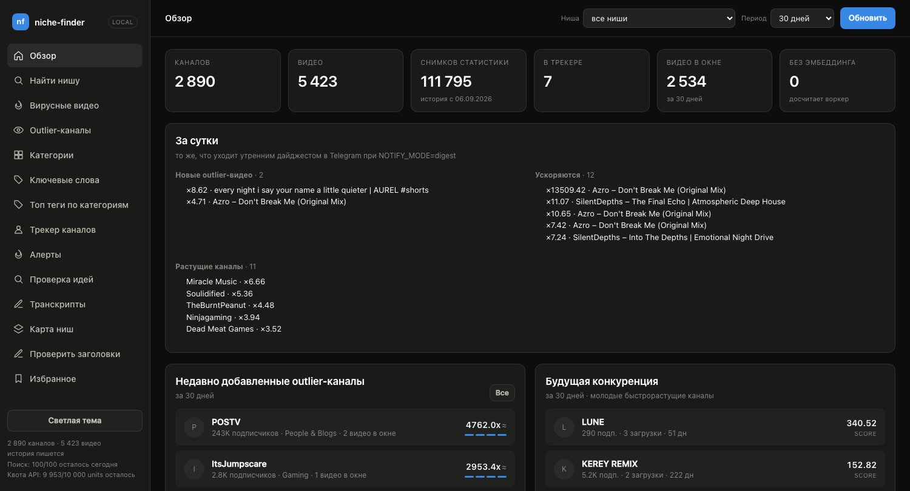

## Contents

- [What it does for you](#what-it-does-for-you)
- [Why niche-finder](#why-niche-finder)
- [Screens](#screens)
- [Plans](#plans)
- [Run it yourself today](#run-it-yourself-today)
- [For developers](#for-developers)
- [Privacy and security](#privacy-and-security)
- [License](#license)

## What it does for you

### Find a niche worth entering

- **Where to enter:** every niche scored 0–100 from six visible terms —
  demand trend, supply growth, newcomers breaking out, RPM, templated
  channels, policy signals — with a side-by-side comparison of 2–3 niches.
- **Viral videos from small channels and outlier channels:** a video against
  its own channel's median, over any period from 24 hours to 90 days, with
  subscriber, length, Shorts, RPM and Partner Program filters.
- **Niche trend:** growing, stable, cooling or saturated, from the last 30
  days against the 90 before — supply, demand, new channels and whether
  newcomers break out.
- **What outliers share:** what a niche's breakouts have in common against
  ordinary videos — a number or "?" in the title, length, tags, weekday and
  time — by the numbers.
- **Language gaps:** formats that took off in one language and whether
  anything like them exists in another.
- Trending categories and keywords, a niche map, the best time to publish,
  and export of a niche's videos to CSV.

### Plan your next video

- **Idea checker:** is a topic free, recently covered, proven or a flop in
  this niche?
- **Outlier to brief:** one click turns a video that beat its channel into a
  working brief — hook, title patterns, whether the topic is covered, title
  candidates and thumbnail references.
- **Metadata review and hook score:** your draft title, description, tags and
  first 30 seconds checked against what worked in the niche.
- **Content gaps:** questions from a niche's comments that no video answers
  yet, ranked by demand.
- **Content calendar:** drafts on a week or month grid with the niche's best
  hours and a reminder the day before.

### Watch competitors and your own channel

- **Channel tracking:** growth by window, views per hour of every upload, a
  revenue range, Partner Program thresholds and the next milestones.
- **Alerts:** a new outlier, accelerating views, a title or thumbnail swap, a
  channel breaking its silence, a new video on a topic you named — on the
  dashboard, in the browser extension, in Telegram or as a morning digest.
- **Repackaging and template risk:** title and thumbnail swaps with views
  before and after; how much a channel's uploads look like one template
  repeated.
- **Collaboration partners and sponsors:** similar channels of your size, and
  which brands pay creators in a niche.
- **Your own channels:** connect them read-only through Google and see your
  real views, retention, revenue and RPM next to the niche; a net profit
  calculator with your own costs.

### Wherever you work

- **A web dashboard** with 26 sections plus niche, channel and brief pages.
- **A Chrome extension** that puts the numbers on top of YouTube itself.
- **Claude Desktop or any MCP client:** 100 tools and 7 ready-made scenarios,
  so you can ask for a niche in plain words.

## Why niche-finder

- **History the API doesn't give you.** YouTube only ever says "how many
  views right now". niche-finder writes the numbers down on a schedule, so
  views per hour, acceleration, subscriber growth and title swaps exist.
- **Honest numbers.** RPM and revenue come as a range, never one invented
  figure; every estimate is labelled as niche-finder's, not YouTube's; below a
  minimum sample you get "not enough data" instead of a guess; there is no
  opaque "SEO score".
- **Answers, not dashboards for their own sake.** Every screen ends in a
  decision: enter this niche or not, film this idea or not, copy this format
  or not.
- **The same numbers everywhere.** The dashboard, the extension and Claude
  call the same calculations, so they can never disagree.

## Screens

<table>
<tr>
<td width="50%">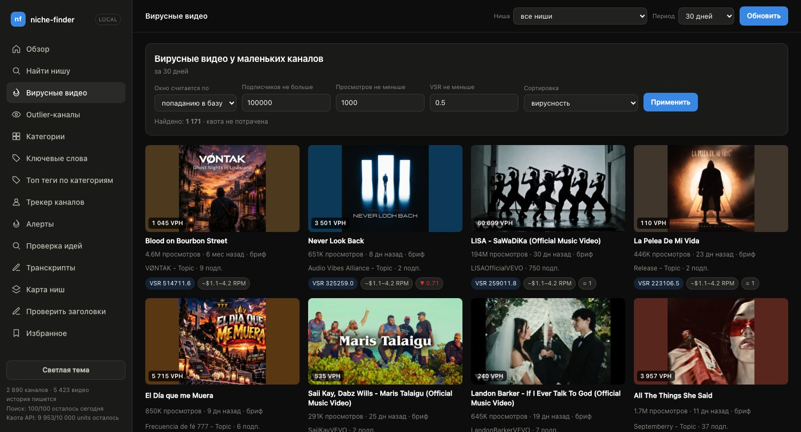<br><sub><b>Viral videos</b> — small channels that beat their expectations</sub></td>
<td width="50%">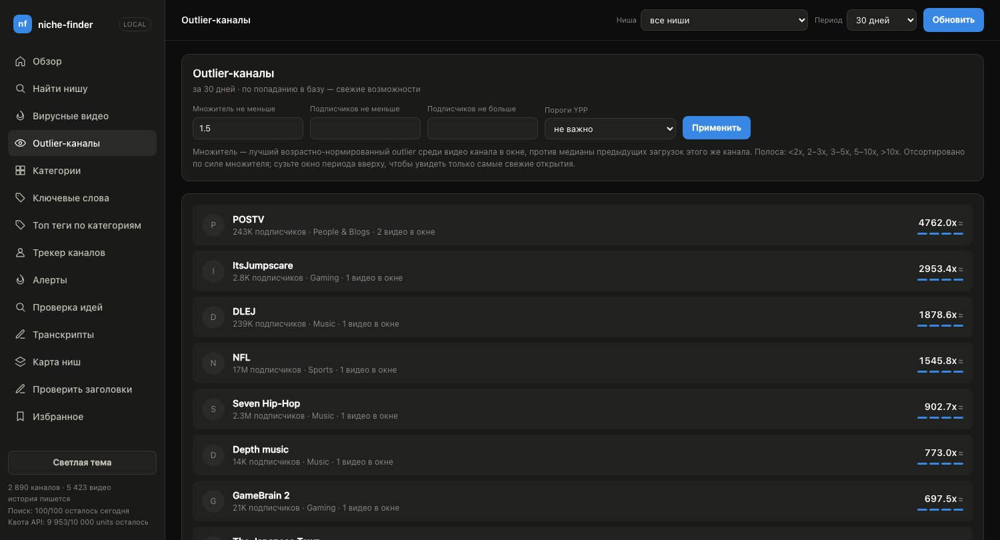<br><sub><b>Outlier channels</b> — best video's multiplier against the channel's median</sub></td>
</tr>
<tr>
<td width="50%">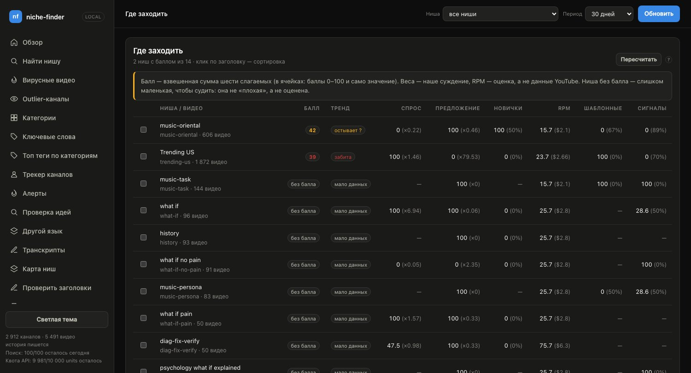<br><sub><b>Where to enter</b> — every niche scored 0–100, each term visible, sortable</sub></td>
<td width="50%">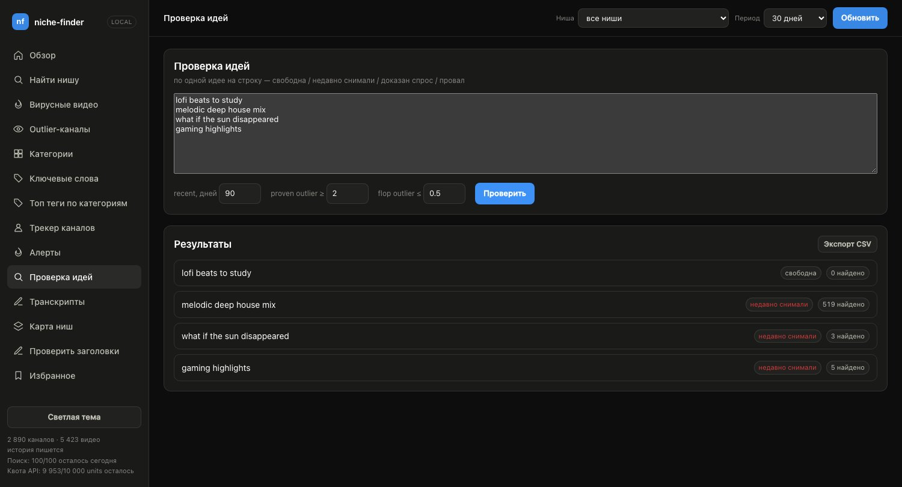<br><sub><b>Idea checker</b> — free, recently covered, proven demand or flop</sub></td>
</tr>
<tr>
<td width="50%">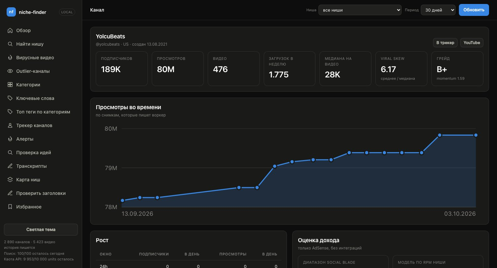<br><sub><b>Channel</b> — growth, snapshots, revenue range, similar channels</sub></td>
<td width="50%">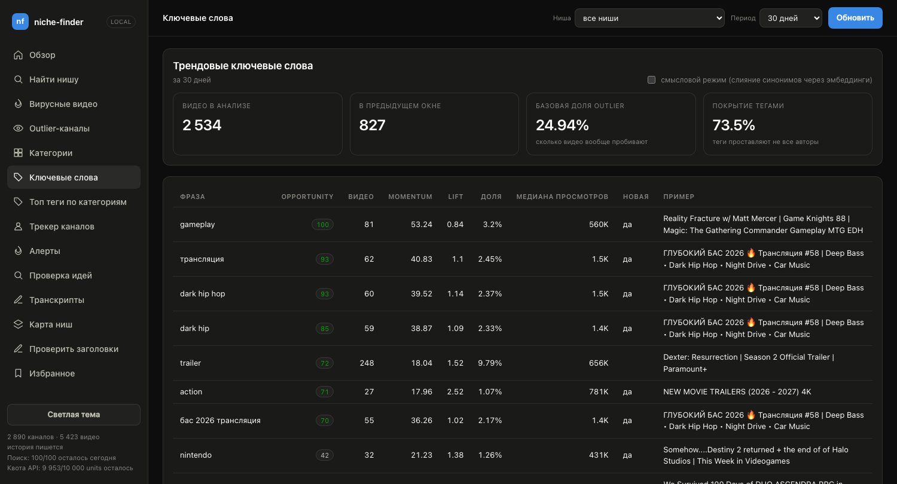<br><sub><b>Keywords</b> — trendScore, lift, momentum</sub></td>
</tr>
<tr>
<td width="50%">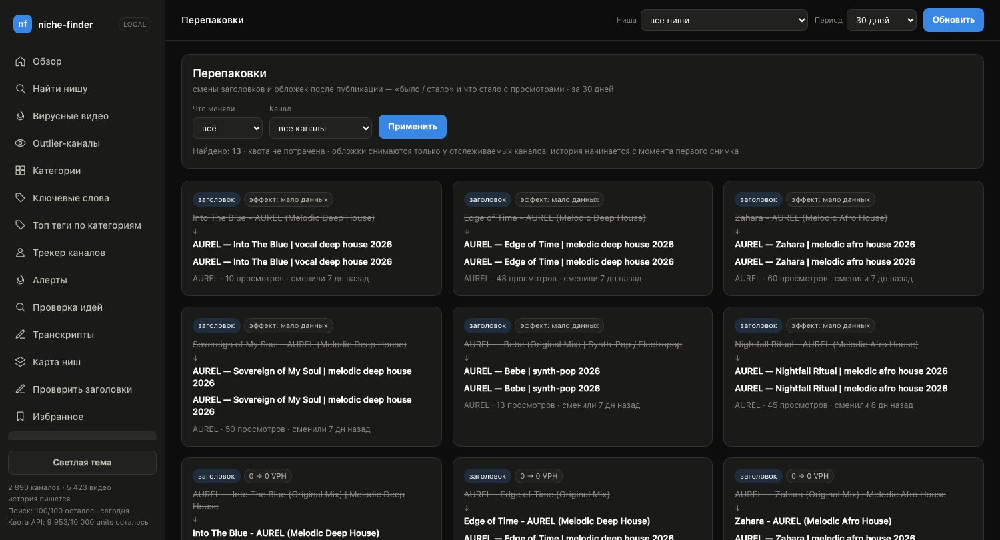<br><sub><b>Repackaging</b> — title and thumbnail changes, before / after</sub></td>
<td width="50%">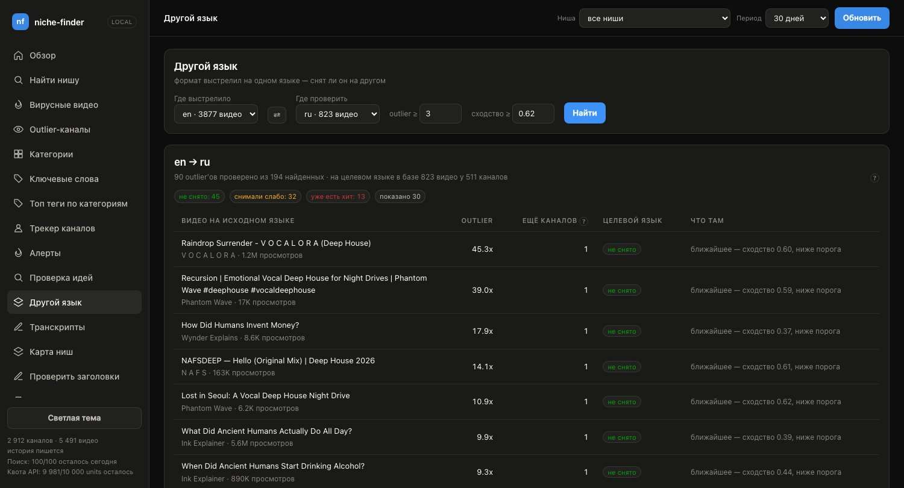<br><sub><b>Another language</b> — outliers in English and whether Russian has anything like them</sub></td>
</tr>
<tr>
<td width="50%">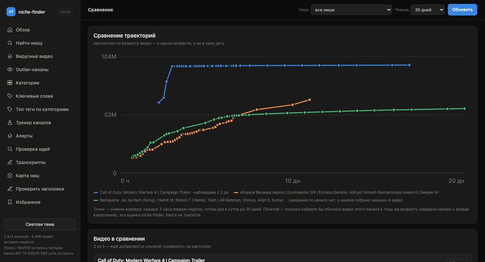<br><sub><b>Compare</b> — views by age for up to five videos, side by side</sub></td>
<td width="50%">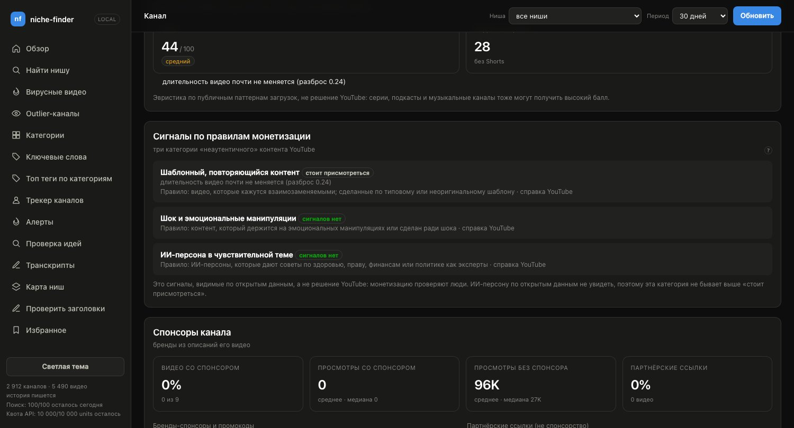<br><sub><b>Policy signals</b> — YouTube's three inauthentic-content categories, no risk percentage</sub></td>
</tr>
<tr>
<td width="50%">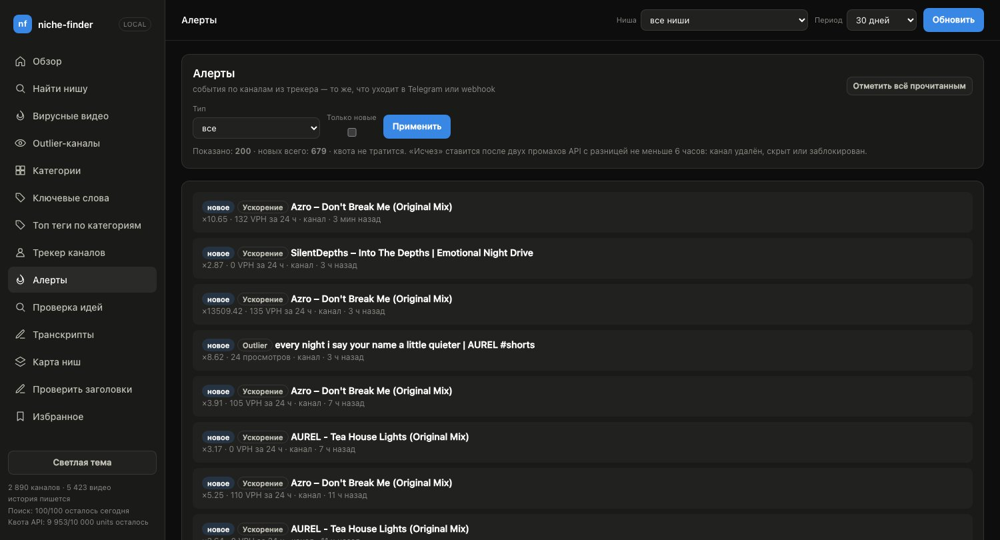<br><sub><b>Alerts</b> — new outliers and accelerating videos on tracked channels</sub></td>
<td width="50%">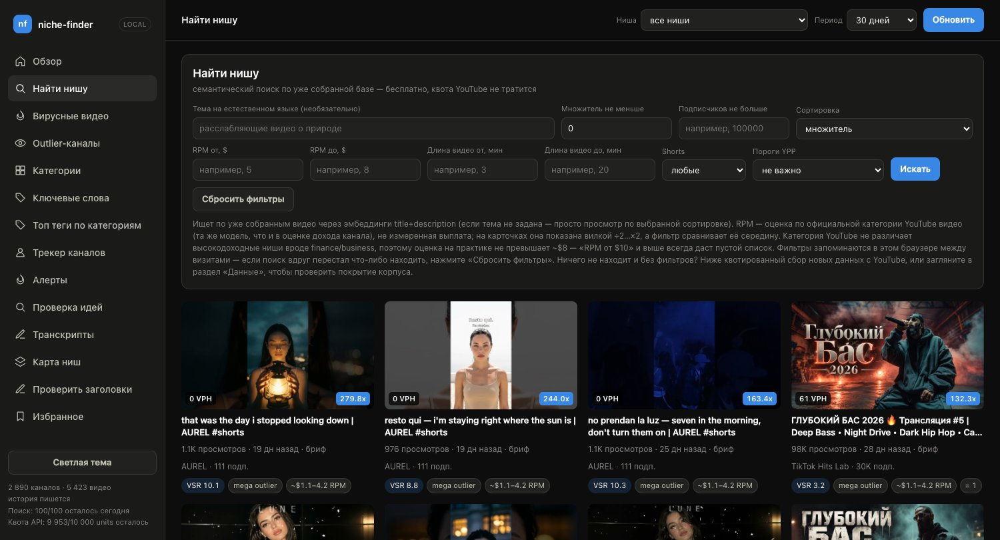<br><sub><b>Find a niche</b> — semantic search over the collected videos</sub></td>
</tr>
</table>

Every screen is described in [frontend/README.md](frontend/README.md#screens).

## Plans

The hosted service will have a free tier and paid tiers. A tier sets how much
you can do per day (YouTube lookups, searches, AI features), how many channels
you can track and connect, and which features are on — for example your own
channel's revenue, the browser extension and MCP, alerts, export. Prices will
be announced at launch; until then, early-access users get the free tier.

The tariff system is already built: an admin defines tiers on the dashboard,
and users switch between free tiers themselves. See
[backend/README.md](backend/README.md#tariffs-saas-sub-project-1-nf_multi_user1).

## Run it yourself today

niche-finder is open source. With Docker and a free YouTube API key you can
run your own copy in a few minutes — the dashboard, the background worker, the
extension and the MCP server for Claude Desktop:

```bash
git clone https://github.com/pandich93/youtube-niche-finder.git
cd youtube-niche-finder
cp .env.example .env          # put your key into YOUTUBE_API_KEY
docker compose build && make up
open http://localhost:8080
```

The full guide — Claude Desktop, the extension, running without Docker, how
it works, giving accounts to other people — is in
[docs/self-hosting.md](docs/self-hosting.md).

## For developers

| Document | What's inside |
|---|---|
| [docs/self-hosting.md](docs/self-hosting.md) | install and run your own copy |
| [backend/README.md](backend/README.md) | YouTube quota, the CLI, all 100 MCP tools and 7 scenarios, tariffs, configuration, formulas, code structure |
| [frontend/README.md](frontend/README.md) | every dashboard screen, where its data comes from, what costs quota |
| [extension/README.md](extension/README.md) | what the extension shows on each YouTube page |
| [docs/http-api.md](docs/http-api.md) | all 137 HTTP routes with parameters, costs and MCP twins (generated from the code) |
| [`.env.example`](.env.example) | every setting, commented in place |
| [CONTRIBUTING.md](CONTRIBUTING.md) · [CHANGELOG.md](CHANGELOG.md) | dev setup and tests; what changed in each release |

| Path | What's inside |
|---|---|
| [`backend/`](backend/README.md) | MCP server, HTTP API, worker and CLI — all logic and storage (Python, FastAPI, PostgreSQL + pgvector) |
| [`frontend/`](frontend/README.md) | the dashboard: plain ES modules, no npm, no build step |
| [`extension/`](extension/README.md) | Chrome extension (Manifest V3): panels and badges on top of YouTube |
| [`docs/`](docs/README.md) | documentation map, self-hosting guide and the HTTP API reference |
| [`scripts/`](scripts) | MCP-in-Docker launcher, diagnostics, the API-docs generator, benchmarks |
| [`infra/caddy/`](infra/caddy) | HTTPS reverse proxy for MCP over HTTP |

Bug reports, fixes and documentation PRs are welcome. For anything bigger —
a new MCP tool, API route or dashboard screen — please open an issue first.
[CONTRIBUTING.md](CONTRIBUTING.md) explains the dev setup and the tests
(`make local-test`, no YouTube key needed).

## Privacy and security

- **Read-only.** niche-finder never uploads, comments or changes anything on
  YouTube. Connecting your channel asks Google for read-only access, and
  revenue is a separate permission you can skip.
- **Your channel, your choice.** Disconnecting a channel revokes the access at
  Google and deletes its data.
- **No selling, no ads, no sharing** of your data.
- **Secrets stay secret.** Refresh tokens are encrypted; API keys never appear
  in URLs or logs.

[PRIVACY.md](PRIVACY.md) lists exactly what is stored and where traffic goes;
[SECURITY.md](SECURITY.md) covers reporting a problem and what protects each
mode.

## License

[MIT](LICENSE). niche-finder is not affiliated with YouTube or Google. It uses
the YouTube API Services under
[YouTube's API Terms of Service](https://developers.google.com/youtube/terms/api-services-terms-of-service).
